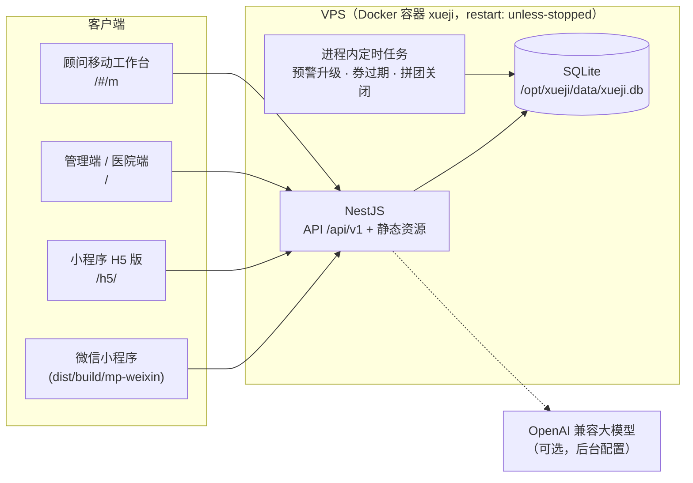

# 雪姬美业六维健康平台 · 产品设计与开发文档 v1.1（黑客松 MVP 迭代）

> **版本** v1.1｜**日期** 2026-10-12｜**基线** v1.0（原始稿，见 `01_产品设计与开发文档_v1.0（原始稿）.md`）｜**状态** MVP 已可演示
>
> 本文档只记录 v1.1 相对 v1.0 的**迭代与取舍**。业务规则、页面规格、数据设计、提示词仍以 v1.0 为准；本文未提及的部分即"按 v1.0 实现"。

## 修订记录

| 版本 | 日期 | 修改内容 |
|---|---|---|
| v1.0 | 2026-10-10 | 初稿 |
| v1.1 | 2026-10-12 | 黑客松 MVP：品牌落地为"雪姬美业"、选定 GitHub 开源框架、三端 + 小程序 H5 版可演示；记录简化项与后续迭代清单 |
| v1.1.1 | 2026-10-12 | 接入五月花店真实信息：美团门店资料与团购项目价格、门店《健康档案表（女）》数字化、鹰眼报告合规评估；新增"门店项目与预约"页、档案表录入、3 条禁忌规则与 2 个方案包 |
| v1.1.2 | 2026-10-12 | 小程序风格向美团门店页靠拢（GitHub issue #1 第一步）：品牌色由酒红改为美团式黄色、全局设计令牌调整、门店项目页改为团购列表样式 |

---

## 1. 本次迭代的目标

参加黑客松，要在最短时间内让**小程序端、管理端（含医院端、顾问移动工作台）进入可演示状态**，并能部署到一台 VPS。按用户要求，**安全与后端基础设施的工程化要求暂缓**，优先保证：

1. 业务闭环跑得通：扫码 / 登录 → 六维测评 → 规则判定风险 → 体检券 → 预约 → 医院回传 → 按医生意见调整方案 → 顾问发送 → 客户查看。
2. 设计文档里"必须遵守"的产品原则在演示中可见：规则定骨架 AI 写文案、红旗不交给 AI、单独同意、乐龄模式、医疗推荐不分等级、数据来源标签、禁忌筛查。
3. 视觉按《小程序页面总图 v2 精修版》还原。

## 2. 品牌与门店

| v1.0 | v1.1 |
|---|---|
| XXX美业（占位） | **雪姬美业**（前台、提示词、文案统一替换） |
| 试点门店（占位） | **雪姬AI智能健康美容体验馆（五月花店）**，另设两家"演示门店"用于看板对比 |
| 合作医院（占位） | `合作医院·健康管理中心（演示）`，许可证号等用 `[待补充]` 标注 |

### 2.1 五月花店真实资料（来源：美团门店页截图，2026-10）

| 项 | 内容 |
|---|---|
| 门店名称 | 雪姬AI智能健康美容体验馆（五月花店） |
| 类目 | 综合美容 SPA，评分 4.8，191 条评价 |
| 位置 | 北京路商业区，五月花商业广场（中山五路店）九楼 902A / 902B 铺 |
| 营业时间 | 10:00–22:00 |
| 设施 | 高清电视、充电宝、沙发位、VIP 包房 |
| 门店承诺 | 无推销办卡、无隐形消费、不满意重做、保证正品、一对一服务、一次性用品 |
| 品牌定位 | "科技护美"：面部护理 + 身体 SPA + 设备评估 |
| 门店电话 | 仍缺，小程序"联系门店"提示改用在线预约（Q19） |

美团页上的美容师姓名、客户评价原文**没有**进入系统；演示员工账号继续用虚构姓名。

### 2.2 门店项目与方案引擎的映射

v1.0 附录 D.2 的 13 个项目是通用设想，五月花店实际在售的是美团团购项目。v1.1.1 把项目表改为"真实在售 + 筹备中 + 合规拦截"三种状态：

| 状态 | 进入方案引擎 | 小程序展示 | 项目 |
|---|---|---|---|
| 已上架（`active`） | ✅ | 显示团购价、门市价、销量 | P01 人鱼水光 ¥291、P02 招牌 SPA 手仪双护 ¥55.8（3 次卡 ¥194）、P04 90 分钟 SPA ¥85、P05 120 分钟全身精油 SPA ¥279.01、P12 菲络嘉补水 ¥490、P14 POLA 深层清洁 ¥58.48（3 次卡 ¥191）、P15 清洁补水 ¥91.8、P16 痘肌护理 ¥62.9、P17 巧克力焕肤 ¥230、P18 冰雪星辰美白 ¥428 |
| 筹备中（`planned`） | ✅，文案附"门店筹备中，顾问会告诉您时间" | 方案页标"门店筹备中"，不出现在门店项目页 | P03 腹部温养、P06 体态调理、P07 体成分管理、P08 轻体能课、P09 正念减压课、P10 产后修复、P11 汗蒸、P13 腿部舒缓（v1.0 方案包需要、门店尚未开设） |
| 合规拦截（`blocked`） | ❌ | 不展示 | P19 德国鹰眼全身健康评估（美团在售 ¥59.9，见 2.4） |

- 价格一律用**美团公开团购价**，同一项目对所有客户一致，不按会员等级区分（与 v1.0 "医疗推荐不分等级"一致）；页面注明"以门店最终报价为准"。
- 每个项目的属性标签（`heat` 热疗、`facial_device` 面部仪器、`deep_pressure` 深层手法、`strong_aroma` 浓香精油等）决定禁忌筛查，**需商学院和设备说明书确认**（Q24）。
- 新增方案包：PK11 痘肌净护计划（`skin_acne` → P16 + P14）、PK12 清透焕亮计划（`skin_pores` / `skin_dull` / `skin_spots` → P15 + P17）；PK06 皮肤计划改为 P14 + P01 + P02。
- 测评题 S02（皮肤困扰）选项拆分出 `skin_aging / skin_spots / skin_dull / skin_pores / skin_dry / skin_sensitive / skin_acne`，驱动上面两个方案包。
- 新增禁忌：CI22 妇科肌瘤 / 增生史 → 腹部、热疗项目操作前确认；CI23 敏感肌 → 面部仪器操作前确认；CI24 过敏史 → 浓香精油、面部仪器操作前确认。CI06（操作前测血压）增加"自述血压偏高"。
- 小程序新增 **门店项目与预约** 页（`/pkg-module/store`）：门店信息、承诺、按"面部护理 / 身体 SPA"分组的项目与价格；点"预约"带入项目名进入意向表单（模块 `store_services`，24 小时内顾问电话确认，不在线收款）。入口：首页布局（6 套中的 5 套）、"我的"菜单、方案页"查看门店全部项目与价格"。

### 2.3 门店《健康档案表（女）》数字化

门店现用纸质《健康档案表（女）》，v1.1.1 做成管理端表单（客户详情"健康档案表"标签页、移动工作台"建档"标签），字段由服务端 `GET /admin/intake/form` 下发：

| 分组 | 字段 | 生成的健康标签 |
|---|---|---|
| 基本情况 | 年龄、身高、体重、生育（敏感）、血压 / 血脂 / 血糖、过敏史 | 血压偏高 → `bp_high_self`；不清楚 → `htn_unknown`；护肤品过敏 → `cosmetic_allergy`；其他过敏 → `allergy_history` |
| 皮肤、头发、指甲、眼睛 | 多选 | 敏感泛红 / 长痘 / 色斑 / 暗沉 / 干燥 → `skin_*` |
| 二便与口干 | 排便、便秘、晨起口干、小便情况 | 经常便秘 → `constipation`（生活建议 L_BOWEL） |
| 女性健康（敏感，可不填） | 甲状腺、白带、子宫肌瘤、增生、月经 | 肌瘤 / 增生 → `gyn_condition`；不规律 → `menstrual_irregular`；痛经 → `dysmenorrhea` |
| 睡眠、不适与病史 | 睡眠、近 1 周不适、手术、慢病史 | 入睡难 / 易醒 / 早醒 → `sleep_issue`；近 3 个月手术 → `recent_surgery`；慢病 → `dx_*`；不适含胸痛、胸闷、大量出血、呼吸困难等关键词 → **L2 预警** |

规则：
1. **数据最小化**：纸质表上的姓名、电话、住址不再收集（客户已在系统里）。
2. **单独同意**：客户未在小程序授权 C2 时，顾问须勾选"已签署纸质《健康信息处理单独同意》"，系统记一条渠道为"纸质"的 C2 授权。
3. 顾问、店长、健康顾问可以录入；**完整内容仅健康顾问可查看**，每次查看写审计日志。
4. 生成的标签来源记为"门店录入"（`staff`），参与禁忌筛查和下一次方案生成；档案时间轴记一条"门店健康档案表（本人自述）"。

### 2.4 鹰眼评估报告的合规评估

用户提供了 3 份真实客户的鹰眼报告用于了解报告结构。为保护客户隐私，只阅读了其中一份的版式，**任何报告内容和个人信息都没有进入代码、种子数据或文档**。

报告结构：生物电 / 频谱类"全身健康评估"，按系统列出几百项评分，并给出脏器疾病风险、用药禁忌、草药与饮食调理建议；报告自称"非医疗诊断软件"。

结论（按 v1.0 第 4.10 节设备准入与附录 I 合规清单）：
- 设备状态保持 `pending`（待审核），审核意见写入设备台账；管理端"设备与测量"页置顶提示，点"准入"前需二次确认。
- 鹰眼数据**不进入客户端、不参与方案引擎和就医推荐**；P19 状态为"合规拦截"。
- 自称"非医疗"却输出疾病风险与用药 / 草药建议，存在超范围宣传风险；美团团购标题"全身 558 项健康评估"及报告措辞需法务审核（Q25）。
- 建议：先确认型号、厂家、是否有医疗器械注册证；若无，报告应删除疾病、用药、治疗相关内容，只保留体验性描述，或下架。


### 2.5 视觉风格：向美团门店页靠拢（进行中，GitHub issue #1）

客户多从美团团购进店，小程序在配色、版式和价格展示上向美团门店页靠拢。品牌色由酒红 `#8C2B56` 改为美团式黄色（管理端暂不变）：

| 令牌 | 值 | 用途 |
|---|---|---|
| `--brand` | `#FFD100` | 主按钮、选中态、进度条、积分卡等底色 |
| `--on-brand` | `#222222` | 黄色底上的文字和图标（黄底白字看不清，一律用深色字） |
| `--brand-ink` | `#8A5A00` | 品牌色的文字、链接、标签字、图标（白底对比度 5.9:1） |
| `--brand-soft` / `--brand-line` | `#FFF8DC` / `#FFE58A` | 浅黄底、描边 |
| `--price` | `#F2481B` | 门店项目价格（只用于门店项目） |

臻享会员深色金色皮肤不变（`--brand-ink`、`--on-brand` 在深色皮肤下另有取值）；医疗青、提示黄、警示红的用途不变。原生 `switch`、`slider` 与弹窗确认按钮只能用十六进制色，分别用 `#F5BE00` 和 `#8A5A00`。

已完成（第一步）：
- 全局设计令牌（`apps/miniapp/src/style/index.scss`）：
  - 中性灰背景 `#F5F5F5` + 白卡片；容器圆角 12、内部元素 8、标签 4。
  - 标准模式边距 12、间距 10；乐龄模式字号、间距、触控区域不变。
  - 文字 `#222 / #555 / #767676`，正文对比度不低于 4.5:1。
  - 导航栏改为白色。
- 新增价格样式，只用于门店项目：
  - `--price` 橙红，大号加粗，满足大字对比度 3:1；`¥` 小、数字大，门市价删除线。
  - 优惠标签 `.tag.promo`。
  - 星级评分 `.stars`。
- 门店项目页：
  - 黄色门店头图（实拍图到位前用插画占位，标"示意图"）。
  - 评分、营业时间、地址（复制）/ 电话。
  - 门店承诺，项目分类切换。
  - 团购列表：左侧缩略图，右侧标题、适用人群与销量、优惠标签、价格、预约按钮。
  - 底部白色操作栏：电话、顾问、预约到店。

约束不变：健康相关页面（测评、报告、档案、预警、就医、魔镜）不使用价格色和促销标签；不加倒计时、"仅剩 N 份"等元素；按钮用"预约"，不用"抢购"。

待做：首页、方案页项目卡、意向表单（P1），其余页面（P2）；门店实拍图需门店提供并确认授权。
## 3. 框架选型（GitHub 开源）

v1.0 13.1 建议"TypeScript 全栈 + uni-app + Vue3 后台 + NestJS"。v1.1 在此基础上选定以下开源框架二次开发：

| 端 | 选用框架 | 仓库 | 选择理由 |
|---|---|---|---|
| 小程序 | **unibest** v4（uni-app + Vue3 + TS + Vite + UnoCSS） | github.com/feige996/unibest | 与 v1.0 技术栈完全一致；约定式路由与分包、自定义 tabbar、UnoCSS 图标；一套代码同时编译**微信小程序**和 **H5**（演示时手机浏览器直接打开） |
| 管理端 / 医院端 / 移动工作台 | **pure-admin-thin** v6（Vue3 + Element Plus + Vite + Pinia + ECharts） | github.com/pure-admin/pure-admin-thin | vue-pure-admin 官方精简版，布局、菜单、标签页、按角色过滤路由开箱即用；同一工程承载三个入口 |
| 后端 | **NestJS 11 + Prisma 6** | github.com/nestjs/nest、github.com/prisma/prisma | 与 v1.0 一致；Prisma schema 即数据设计文档 |
| 规则引擎 | **json-logic-js** | github.com/jwadhams/json-logic-js | v1.0 指定；规则条件存数据库、可在后台编辑和模拟 |
| 图标 | **Tabler Icons**（@iconify-json/tabler） | github.com/tabler/tabler-icons | 总图 v2 指定的图标库，小程序与后台统一 |

## 4. 工程结构

```text
XueJiMeiYe/
├── apps/
│   ├── miniapp/            # unibest：微信小程序 + H5（演示版）
│   │   ├── src/pages/      # 主包：首页、档案、魔镜、我的（4 个 tab）
│   │   ├── src/pkg-*/      # 11 个分包 37 页 + 主包 4 页，共 41 页（对应 v1.0 5.2 页面清单）
│   │   ├── src/components/ # 首页配置驱动渲染器、雷达图、图标、导航
│   │   └── src/xj/         # 请求封装、登录态 / 乐龄模式状态、朗读与图表工具
│   ├── admin/              # pure-admin-thin：管理端 + 医院端 + 移动工作台（/m）
│   │   └── src/views/      # 29 个业务页面
│   └── server/             # NestJS API（176 个接口）
│       ├── prisma/         # schema.prisma（62 张表）、seed（演示数据）
│       └── src/engine/     # 规则引擎（纯函数）：题库、计分、红旗、风险信号、禁忌、方案骨架、模板文案
├── deploy/                 # 构建、上传脚本，Dockerfile / docker-compose / nginx 配置
└── docs/                   # 本文档、v1.0 原始稿
```

## 5. 架构与部署（MVP）



一个 Node 进程同时提供 API、管理端静态页和小程序 H5 版，运行在 Docker 容器 `xueji` 中（镜像 `node:22-bookworm-slim`，非 root 用户 uid 10001）。容器设置 `restart: unless-stopped`，Docker 开机自启，进程崩溃或服务器重启后自动恢复，不依赖任何人工或开发机上的后台任务。数据库挂载在宿主机 `/opt/xueji/data`，重建镜像不丢数据。Nginx 可选（有域名 / HTTPS 时使用 `deploy/nginx.conf`）。

## 6. 相对 v1.0 的简化与取舍

> 下表中的简化**仅用于黑客松演示**，正式上线前必须按 v1.0 第 11、13、14 章补齐。

| 领域 | v1.0 要求 | v1.1 MVP 做法 | 回补优先级 |
|---|---|---|---|
| 数据库 | MySQL 8 托管版 | **SQLite**（本地 / VPS）；`DB_PROVIDER=mysql` 切 MySQL（微信云托管），见 README「数据库开关」 | 高 |
| 字段加密 | `_enc` 字段 AES-256-GCM + KMS | 明文存储，字段名保留语义 | 高 |
| 缓存与队列 | Redis + BullMQ | **进程内定时器**（`JobsService`，每 5 分钟：L3 超时升级、券过期、拼团关闭） | 中 |
| 文件存储 | COS 私有桶 + 签名链接 | 未接入；报告原件 PDF 以占位提示 | 中 |
| 微信登录 | `wx.login` + code2Session + 手机号快速验证 | 演示登录：输入手机号即可；`wx.login` 已调用但 openid 由服务端模拟；另提供**演示账号**一键进入 | 高（需小程序 AppID / Secret） |
| 后台登录 | 密码 + 图形码 + 短信动态码 / 企微扫码 | 账号密码（演示密码统一 123456），JWT 12 小时 | 高 |
| 企业微信 | 免登、应用消息、通讯录同步 | **员工站内通知**模拟企微应用消息（工作台"企微消息（模拟）"面板）；移动工作台用同一账号登录 | 中 |
| RBAC | role / permission / 数据范围 | 员工单角色 + 数据范围（全部 / 本店 / 本人）；后端按角色校验关键操作，前端按角色过滤菜单 | 中 |
| 订阅消息 / 短信 | 一次性订阅消息、短信备用 | 客户站内消息（"我的 - 消息中心"）；小程序端保留订阅入口 | 中 |
| 语音 | 腾讯云 ASR / TTS（含粤语） | H5 使用浏览器语音合成朗读、浏览器语音识别"说出答案 / 按住说话"；小程序端提示待接入"同声传译"插件 | 中 |
| 魔镜流式输出 | HTTP chunked + `enableChunked` | 一次返回 + 前端逐字显示 | 低 |
| AI 网关 | 场景路由、熔断、内容安全 | OpenAI 兼容接口（后台"系统管理 - AI 参数"可配置）、超时重试、调用日志、手机号脱敏；**未配置时全部走模板文案**；内容安全接口未接 | 中 |
| 照片对比、粤语、记忆提取定时任务 | V1.2 | 未做；魔镜记忆支持"记下……"主动记录与查看删除 | 低 |
| 测试 | 规则 100% 覆盖、红队集 | 后台"方案引擎 - 用测试集跑一遍"（7 个回归用例）；单元测试待补 | 高 |

## 7. 已实现功能对照（按 v1.0 版本规划）

### 7.1 用户端（小程序 / H5，41 页）

| v1.0 页面 | 状态 | 说明 |
|---|---|---|
| P-01 首页（配置驱动） | ✅ | 3 等级 × 乐龄模式 6 套布局；组件按 4.3 可见性过滤；臻享深色金色皮肤；乐龄宫格主入口占两格；网络失败显示缓存 |
| P-05 ~ P-07 登录、授权、基础资料 | ✅ | C1 主动勾选；≥60 岁自动开启乐龄模式，50–59 岁询问；手机号匹配老客户继承等级与顾问；小程序码 `scene=q=短码` 归属 |
| P-08 ~ P-14 六维测评 | ✅ | 60 题题库（附录 C）；JSON Logic 分支题；逐题保存；**任一题命中 L3 立即跳转紧急页**；30 秒坐站 / 单腿站立小测；结果页三件事、雷达图本次与上次对比、就医建议、体检券、初步方案；乐龄模式一页一题、自动朗读、语音作答；演示助手可一键填完剩余题 |
| P-02、P-15 ~ P-19 档案 | ✅ | 指数趋势、指标卡（医院出具 / 门店测量 / 本人记录三色来源标签）、时间轴、报告 8 段式结构、指标趋势（3 / 6 / 12 个月、参考区间）、医院报告（医生原文 + 通俗版） |
| P-20 我的方案 | ✅ | 就医建议放最前、医生建议、门店安排、日常建议、跟进计划；仅"已发送"可见；L2/L3 显示暂停 |
| P-21 / P-22 体检券与预约 | ✅ | 券面承诺文案；号源日历（医院端实时）；C3 必需 / C4 可选独立开关，**默认不勾选**；接送陪同需求；L2 转介模式 |
| P-03 魔镜 | ✅ | 常驻"我是 AI 助手"；快捷话题；关键词 + 模型双重风险分类，高风险固定安全话术 + 安全卡片 + 预警；C9 记忆同意与"记得的事"；AI 未配置时模板陪聊可读报告和待办 |
| P-23 ~ P-26 模块详情、意向、海外 VIP、接送 | ✅ | 健康提示按健康标签命中、需勾选"我已了解"；合作方资质展示；表单由模块配置生成；VIP 深色页 |
| P-27 ~ P-31 存折、打卡、问答、翻牌、拼团 | ✅ | 存折样式明细；打卡积分上限；每日 3 题；3 档翻牌；预约制拼团（不收款、无分享奖励） |
| P-32 ~ P-35 家人 | ✅ | 邀请链接（72 小时）→ 家人接受 → 本人确认并逐项勾选可见范围（C6）；家人视角"妈妈的健康"一页纸摘要 |
| 门店项目与预约（v1.1.1 新增） | ✅ | 五月花店真实资料、承诺、团购价；点项目带入预约意向 |
| P-36 ~ P-42 我的、设置、授权、隐私、消息、关于 | ✅ | 公开权益对照表与等级规则；C1–C9 状态与撤回（撤回后果按 9.10 执行）；导出 / 注销申请；AI 使用说明与合作机构资质 |
| P-18 照片对比、P-41 记忆提取任务 | ⏸ | V1.2 |

### 7.2 管理端（含医院端、移动工作台，29 页）

| 菜单 | 页面 | 状态 |
|---|---|---|
| 工作台 | 待办（倒计时、超时标红）、预警置顶、企微消息（模拟）、今日、数据卡片、趋势与分布图 | ✅ |
| 客户 | 客户列表（筛选、脱敏手机号）、客户详情 11 个标签页（**打开"测评与档案"写审计日志，仅健康顾问可见**；"健康档案表"录入纸质表，见 2.3）、分级管理（阈值模拟、分布直方图、发布、等级变更记录、人工调整锁定 6 个月） | ✅ |
| 健康 | 风险预警（联系记录、连续 3 次未接通提示联系家人、关闭需结论、L3 复核）、方案管理（骨架 JSON、客户 / 顾问 / 医生三版、AI 校验记录、审核编辑、复制企微话术、标记发送）、测评记录与陪填码、报告审核、体检券核销与作废、转介单与共享快照 | ✅ |
| 配置 | 模块管理（合规状态流转、健康提示、表单配置、H5 预览）、**首页配置**（6 套布局、组件库、属性面板、手机预览、校验发布、版本回滚）、测评题库（模拟测评）、方案引擎（红旗 / L1 / 禁忌 / 方案包 / 项目 / 生活建议 / 话术 / 医疗目录，可编辑规则并跑测试集）、设备准入与门店测量录入、合规文本 | ✅ |
| 营销 | 线索管理（跟进、转交合作方、成交、丢单原因）、活动 / 拼团 / 问答题库 / 存折规则 | ✅ |
| 合作方 | 合作医院（套餐、协议价、账号）、旅行社 / 机构（资质、合同到期提醒） | ✅ |
| 魔镜 | 人设配置、风险预警（只显示触发片段）、匿名化抽检（写审计） | ✅ |
| 数据 | 北极星指标、转化漏斗、分级、风险、门店、模块、安全、AI 质量 | ✅ |
| 系统 | 门店、员工、消费流水 CSV 导入（预检 → 导入 → 等级重算）、小程序码、操作日志、**AI 参数** | ✅ |
| 医院端 | 转介单（按状态分栏、接收 / 拒绝 / 预约 / 到院 / **回传**，未授权 C4 时回传置灰）、号源日历、服务与套餐、对账（按完成套餐数）、账号 | ✅ |
| 移动工作台 `/#/m` | 我的任务（L3 置顶、一键拨号、记录联系结果）、待发送方案、客户搜索（不显示完整健康数据）、**建档（健康档案表）**、扫码核销、陪填、**服务前禁忌确认** | ✅ |

### 7.3 规则引擎（`apps/server/src/engine`）

| 内容 | 数量 | 来源 |
|---|---|---|
| 测评题目 | 60 | 附录 C |
| 红旗规则 | 13（L3 × 6、L2 × 7） | 附录 A |
| 风险信号 | 15 | 附录 B |
| 禁忌规则 | 24 | 附录 D.3 + v1.1.1 新增 3 条 |
| 门店项目 | 19（上架 10、筹备 8、拦截 1） | 美团在售 + 附录 D.2，见 2.2 |
| 方案包 | 12 | 附录 E + v1.1.1 新增 2 个 |
| 生活建议 | 15 | 4.7.2 + v1.1.1 新增 |
| 计算值 | BMI、OSTA、SARC-F、PHQ-2、GAD-2、坐站参考值、跌倒 3 问 | 4.6 |

骨架生成严格按 4.7.2：红旗优先 → 选主 / 辅方案包 → 取项目过禁忌（block 移除并记录、warn 保留并提示）→ 医生限制标签（`doctor_hold_*`）→ L1 就医建议 → 生活建议 → 跟进计划。文案环节：L2/L3 固定模板；L0/L1 有 AI 时按 P1 提示词生成并做结构、骨架一致、禁用词三项校验，失败重试 1 次后回退模板。

## 8. 演示指南

### 8.1 访问地址（部署后）

| 入口 | 地址 |
|---|---|
| 小程序 H5 版（手机浏览器打开） | `http://<服务器>/h5/` |
| 管理端 / 医院端 | `http://<服务器>/` |
| 顾问移动工作台 | `http://<服务器>/#/m`（先在管理端登录） |
| 微信小程序 | 微信开发者工具导入 `apps/miniapp/dist/build/mp-weixin`（需替换 AppID 与 HTTPS 域名） |

### 8.2 演示账号

**小程序端**（登录页"演示账号"一键进入）：

| 账号 | 用途 |
|---|---|
| 王阿姨（62 岁，悦享，乐龄模式） | 完整档案：两次测评、门店测量、医院回传（骨密度 T 值 -2.1、暂停重手法）、按医生意见调整后的方案、魔镜记忆、家人绑定 |
| 刘阿姨（66 岁，悦享，新客） | 现场演示完整测评 → 体检券 → 预约 |
| 陈总（48 岁，臻享） | 深色金色首页、海外 VIP、接送 |
| 李女士（35 岁，尊享） | 标准模式首页；方案待健康顾问审核 |
| 小周（王阿姨的女儿） | 家人视角"妈妈的健康" |
| 黄阿姨（尊享，L2） | 就医优先、门店项目暂停 |

**管理端**（登录页点击账号直接登录，密码均为 `123456`）：

| 账号 | 角色 |
|---|---|
| admin | 超级管理员 |
| yunying | 总部运营 |
| dianzhang | 店长（五月花店） |
| guwen | 顾问 阿敏（王阿姨、刘阿姨、李女士的顾问） |
| jiankang | 健康顾问（方案审核、报告审核、健康数据） |
| caiwu | 财务 |
| yiyuan / yisheng / yyadmin | 医院协调员 / 医生 / 医院管理员（医院端） |

### 8.3 五分钟路演脚本

1. **乐龄首页**（王阿姨）：大字、主入口、健康卡指数 68 比上次 +22；右上角一键切换乐龄模式。切换陈总，展示臻享深色金色首页——同一套代码，后台"首页配置"决定 6 套布局。
2. **六维测评**（刘阿姨）：同意 C2（单独同意、不默认勾选）→ 健康安全关勾选"高血压"后自动出现"血压控制得怎么样"（分支题）→ 演示"胸痛"选"有"，立即弹出**紧急就医页**（不等测评结束），后台同步出现 L3 预警和 1 小时倒计时 → 返回，用演示助手填完 → 结果页：三件事、雷达图、就医建议、乐龄体检券、初步方案。
3. **后台闭环**（健康顾问 jiankang）：方案管理打开刘阿姨的方案——骨架 JSON（禁忌拦截记录）、客户版 / 顾问版 / 医生版；审核通过。顾问 guwen 在移动工作台复制企微话术并标记发送。
4. **体检与医院**：体检券核销"到店领取" → 刘阿姨预约日期（C3 必需、C4 可选）→ 医院端 yiyuan 接收、到院 → 医生回传结论、勾选"暂停重手法" → 系统自动生成新方案，移除深层按压项目，通知顾问 48 小时内调整。
5. **魔镜**：王阿姨说"读我的报告"；再输入一句情绪低落的话，展示安全卡片和后台魔镜预警（只显示触发片段）。
6. **数据看板**：北极星指标、漏斗、分级分布、AI 质量。

> 配置大模型（后台"系统管理 - AI 参数"，任一 OpenAI 兼容服务）后，方案文案、魔镜对话、医生原话通俗化、门店报告解读会切换为 AI 生成，并在方案详情中显示校验记录。

## 9. 部署

### 9.1 演示环境

> 服务器地址、账号等环境信息不写入文档，另行提供。

| 项目 | 值 |
|---|---|
| 运行方式 | Docker Compose，容器 `xueji`，镜像 `xueji-health:latest`，`restart: unless-stopped`，日志轮转 10 MB × 3 |
| 访问范围 | **仅内网（VPN）可访问，不对公网开放**：容器使用主机网络，端口受主机防火墙管控。不使用 Docker 端口映射，因为它会绕过主机防火墙 |
| 管理端 / 医院端 | `http://<服务器地址>:3000/` |
| 顾问移动工作台 | `http://<服务器地址>:3000/#/m` |
| 小程序 H5 版 | `http://<服务器地址>:3000/h5/` |
| 安装目录 | `/opt/xueji`：`docker-compose.yml`、`Dockerfile`、`xueji.env`（JWT 密钥与 AI 配置，权限 600，不入库）、`data/`（SQLite 数据库） |
| 时区 | 容器内 `TZ=Asia/Shanghai` |

常用命令（在 VPS 的 `/opt/xueji` 下执行）：

```bash
docker compose ps
```

```bash
docker compose logs -f --tail 100
```

```bash
docker compose restart
```

演示时观众设备需接入同一内网。如需公网访问（如评委用手机直接打开），需要另外决定：在防火墙放行 3000 端口，或配置域名 + Nginx + HTTPS。

### 9.2 发布与更新

前端在本地构建（VPS 内存较小），镜像在 VPS 上构建：

```bash
deploy/deploy.sh root@<服务器地址>
```

```bash
SYNC_CONFIG=1 deploy/deploy.sh root@<服务器地址>
```

```bash
RESEED=1 deploy/deploy.sh root@<服务器地址>
```

第二条在发布后执行 `prisma/sync-config.ts`：增量同步门店资料、项目、规则、方案包、生活建议、题库选项、新增模块、首页布局（有变化时发布新版本）、设备台账，并按项目编码刷新已有方案中的项目名称与价格；**保留客户、测评、方案等业务数据**，但会覆盖管理端对上述配置的手工修改。第三条会清空并重置全部演示数据。流程：`build.sh` 本地构建 API、管理端、小程序 H5 并组装部署包 → rsync 上传到 `/opt/xueji`（保留 `data/` 与 `xueji.env`）→ `remote-setup.sh` 执行 `docker compose up -d --build` → 健康检查。容器首次启动且 `data/xueji.db` 不存在时自动初始化演示数据，之后每次启动只同步表结构。

微信小程序正式运行还需要：已注册的小程序 AppID（`apps/miniapp/env/.env` 中 `VITE_WX_APPID`）、备案域名 + HTTPS（`.env.production` 中 `VITE_MP_SERVER_BASEURL`）、在小程序后台配置 request 合法域名。

## 10. 待确认问题（新增）

| 编号 | 问题 | 负责 |
|---|---|---|
| Q19 | ~~五月花店地址、营业时间、项目与价格~~（已按美团资料补齐，见 2.1 / 2.2）；**仍缺：门店电话、床位数、美容师排班** | 雪姬美业 |
| Q20 | 小程序 AppID、AppSecret、服务类目 | 雪姬美业行政 |
| Q21 | 演示 / 正式环境的域名与 ICP 备案、HTTPS 证书 | 雪姬美业 |
| Q22 | 大模型服务商与 API Key（DeepSeek / 通义千问 / 智谱等，需已备案） | 雪姬美业 + 开发 |
| Q23 | ~~VPS 地址、操作系统、SSH 账号~~（已提供并部署） | 雪姬美业 |
| Q24 | 在售项目的属性标签（热疗、面部仪器、深层手法、浓香精油）与禁忌，需商学院和产品说明书确认 | 商学院 + 健康顾问 |
| Q25 | 鹰眼（对应 v1.0 Q08）：型号、厂家、注册证；团购标题与报告中疾病 / 用药 / 草药内容的法务审核 | 店长 + 法务 |
| Q26 | 纸质《健康档案表》停用时间；纸质 C2 授权书模板 | 店长 + 法务 |

## 11. 下一轮迭代清单

| 优先级 | 事项 |
|---|---|
| P0 | MySQL + 字段加密（11.4）、真实微信登录与手机号快速验证、后台短信动态码、HTTPS 与备案域名 |
| P0 | `engine` 单元测试（每条红旗、禁忌规则命中 / 不命中各一例）与 17.3 回归测试集 |
| P1 | 企业微信自建应用：免登、应用消息、通讯录同步；订阅消息模板 |
| P1 | Redis + BullMQ 任务（记忆提取、提醒、对账单生成）；COS 私有桶与报告 PDF |
| P1 | 腾讯云 ASR / TTS（普通话、粤语）、内容安全接口、魔镜流式输出 |
| P2 | 照片对比（C5）、年度健康报告、首页 A/B 测试、数据导出审批 |
