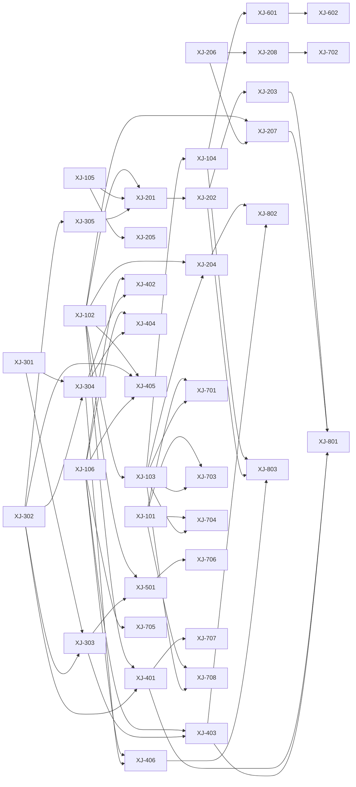

# Issue 看板 · 雪姬美业互动化改版

共 **42** 个 Issue，按波次编排。每个 Issue 都可被一个 AI Agent 独立认领。

## 进度概览

| 状态 | 数量 | 含义 |
|---|---:|---|
| `ready` | 0 | 可认领（还需检查 deps 是否已 done） |
| `claimed` | 0 | 已认领，开发中 |
| `in_review` | 0 | 已提交，待评审 / 合并 |
| `done` | 42 | 已完成并合并 |

**完成度：42 / 42（100%）** · 状态台账见 `scripts/issue-status.json`

## 波次总览

| 波次 | 主题 | Issue 数 | 说明 |
|---|---|---:|---|
| `W0` | 决策门 | 1 | 21 项决议已全部定稿，**无待定项**；下游直接按决议执行。 |
| `W1` | 地基 | 7 | 设计令牌、公共组件、工程基建、路由预登记。所有后续波次的前置。 |
| `W2` | 主 Tab 体验 | 8 | 四个主 Tab 的视觉与互动升级，用户感知最直接的一波。 |
| `W3` | 后端数据与服务 | 5 | 三张新表 + 10 个接口。与 W2 并行，前端按契约先做。 |
| `W4` | 互动玩法 | 6 | 六个新玩法页面，依赖 W3 的接口落地。 |
| `W5` | 成长体系 | 1 | 「我的」页成长可视化，依赖徽章接口。 |
| `W6` | 图形资源 | 3 | 图形补齐、图标枚举固定、死资源回收。 |
| `W7` | 内部页面动态化 | 8 | 按模块分组的批量动效与视觉升级，可高度并行。 |
| `W8` | 质量验收 | 3 | 性能、无障碍、视觉回归三道闸门，最后一道放行。 |

## Agent 分工

| Agent | 角色 | Issue 数 | 说明 |
|---|---|---:|---|
| `fe` | 前端页面 Agent | 22 | 页面与业务组件。只消费 ds 产出的组件与令牌，不新增全局令牌。 |
| `be` | 后端服务 Agent | 6 | NestJS 控制器 + Prisma 模型 + 服务层。接口契约先行，前端按契约并行。 |
| `ds` | 设计系统 Agent | 9 | 令牌、公共组件、样式底座。产出物必须被多个页面复用，不写业务请求。 |
| `infra` | 工程基建 Agent | 1 | 构建、校验、CI、沙箱适配。所有 Agent 的公共依赖，工期最短、优先级最高。 |
| `qa` | 质量验收 Agent | 3 | 真机性能、无障碍、视觉回归。只出报告与阻断结论，不改业务代码。 |
| `pm` | 产品决策 Agent | 1 | 维护 Issue 包与决策门，裁定冲突，不写代码。 |

## 依赖关系

### W0 · 决策门

| ID | 状态 | 标题 | Agent | 优先级 | 规模 | 前置 | 决策 |
|---|---|---|---|---|---|---|---|
| `XJ-000` | ✅ done | 决策门：21 项决议定稿（已完成） | `pm` | P0 | S | — | D1 D2 D3 D4 D5 D6 D7 D8 D9 D10 D11 D12 D13 D14 D15 D16 D17 D18 D19 D20 D21 |

### W1 · 地基

| ID | 状态 | 标题 | Agent | 优先级 | 规模 | 前置 | 决策 |
|---|---|---|---|---|---|---|---|
| `XJ-101` | ✅ done | 工程基建：构建与校验脚本化、CI 入口 | `infra` | P0 | S | — | — |
| `XJ-102` | ✅ done | 设计令牌扩展：达标语义色、徽章、任务完成态、印章、周报封面 | `ds` | P0 | S | — | — |
| `XJ-103` | ✅ done | 视觉细节令牌落地：间距阶梯、圆角阶梯、阴影三层、渐变方向 | `ds` | P1 | M | `XJ-102` | D11 D12 |
| `XJ-104` | ✅ done | 图标与图形底座三档统一（28/38/46，乐龄 34/46/56） | `ds` | P1 | S | `XJ-103` | D13 D14 |
| `XJ-105` | ✅ done | 小镜 CSS 合成形象组件 XMascot | `ds` | P0 | M | — | D19 |
| `XJ-106` | ✅ done | 路由与分包预登记：5 个新页面占位 | `fe` | P0 | S | — | — |
| `XJ-107` | ✅ done | 收口卡：接管动效/图形/入口零归属文件，修复按压反馈 | `ds` | P0 | S | — | — |

### W2 · 主 Tab 体验

| ID | 状态 | 标题 | Agent | 优先级 | 规模 | 前置 | 决策 |
|---|---|---|---|---|---|---|---|
| `XJ-201` | ✅ done | 首页：连续签到激活条 + 「今日 3 件事」任务卡 + 小镜入口 | `fe` | P0 | L | `XJ-102` `XJ-105` `XJ-305` | D1 D8 D21 |
| `XJ-202` | ✅ done | 首页组件启用矩阵：访客 / C 悦享 / B 尊享 / A 臻享 | `fe` | P1 | M | `XJ-201` | D6 |
| `XJ-203` | ✅ done | 乐龄版首页：墨绿大字号、家人入口前置、语音小镜条 | `fe` | P1 | M | `XJ-202` | D10 D21 |
| `XJ-204` | ✅ done | A 级臻享夜色金全站适配 | `ds` | P2 | M | `XJ-102` `XJ-103` | D6 |
| `XJ-205` | ✅ done | 魔镜页人格化改造：小镜头像 + 状态 + 回复内行动卡 | `fe` | P0 | M | `XJ-105` | D19 |
| `XJ-206` | ✅ done | 图表组件库：XIndexRing 指数环 + XTrendChart 可点按趋势曲线 | `ds` | P0 | M | — | — |
| `XJ-207` | ✅ done | 档案页数据可视化升级：指数环 + 趋势曲线 + 达标条 + 人话结论 | `fe` | P0 | L | `XJ-102` `XJ-206` | D8 D20 |
| `XJ-208` | ✅ done | 测评流程可视化：答题进度环 + 雷达生长 + 结果分维度卡片化 | `fe` | P1 | M | `XJ-206` | D17 |

### W3 · 后端数据与服务

| ID | 状态 | 标题 | Agent | 优先级 | 规模 | 前置 | 决策 |
|---|---|---|---|---|---|---|---|
| `XJ-301` | ✅ done | Prisma 三张新表：UserBadge / FamilyRelay / StoreStamp | `be` | P0 | M | — | D2 D3 D7 |
| `XJ-302` | ✅ done | 后端：签到扩展字段 + 六维周报聚合接口 + 档案结论字段 | `be` | P0 | M | — | D5 D20 |
| `XJ-303` | ✅ done | 后端：成就徽章接口 + /app/me 扩字段 | `be` | P0 | M | `XJ-301` `XJ-302` | D2 |
| `XJ-304` | ✅ done | 后端：接力棒 / 健康盲盒 / 门店集章册接口 | `be` | P1 | L | `XJ-301` `XJ-302` | D3 D4 D7 |
| `XJ-305` | ✅ done | 后端：首页「今日 3 件事」动态生成 | `be` | P0 | M | `XJ-302` | D1 |

### W4 · 互动玩法

| ID | 状态 | 标题 | Agent | 优先级 | 规模 | 前置 | 决策 |
|---|---|---|---|---|---|---|---|
| `XJ-401` | ✅ done | 签到日历改造：月历网格 + 7 格奖励轨道 + 里程碑 | `fe` | P0 | L | `XJ-102` `XJ-302` | D8 |
| `XJ-402` | ✅ done | 健康接力棒：与家人互接的健康打卡 | `fe` | P1 | M | `XJ-106` `XJ-304` | D3 |
| `XJ-403` | ✅ done | 成就徽章墙：3 组 24 枚 + 进度环 + 详情展开 | `fe` | P1 | M | `XJ-106` `XJ-303` | D2 D18 |
| `XJ-404` | ✅ done | 健康盲盒：知识卡收藏玩法 | `fe` | P2 | M | `XJ-106` `XJ-304` | D4 |
| `XJ-405` | ✅ done | 六维周报：夜色黑金封面 + 六维环比 + 可分享 | `fe` | P2 | M | `XJ-102` `XJ-302` `XJ-106` | D5 |
| `XJ-406` | ✅ done | 门店集章册：印章收集形态（不做地图打点） | `fe` | P2 | M | `XJ-106` `XJ-304` | D7 |

### W5 · 成长体系

| ID | 状态 | 标题 | Agent | 优先级 | 规模 | 前置 | 决策 |
|---|---|---|---|---|---|---|---|
| `XJ-501` | ✅ done | 「我的」页成长体系：等级进度条 + 徽章行 + 存折横幅 + 快完成了 | `fe` | P1 | M | `XJ-102` `XJ-303` | — |

### W6 · 图形资源

| ID | 状态 | 标题 | Agent | 优先级 | 规模 | 前置 | 决策 |
|---|---|---|---|---|---|---|---|
| `XJ-601` | ✅ done | 图形资源补齐：维度标识、封面占位、加载环、空状态 | `ds` | P1 | M | `XJ-104` | D17 |
| `XJ-602` | ✅ done | 图标语义枚举固定 + 前端映射层（为 .ic-chip 彩色化铺路） | `be` | P1 | S | `XJ-601` | D14 D15 |
| `XJ-603` | ✅ done | 死资源清理与包体积回收 | `ds` | P2 | S | — | D16 |

### W7 · 内部页面动态化

| ID | 状态 | 标题 | Agent | 优先级 | 规模 | 前置 | 决策 |
|---|---|---|---|---|---|---|---|
| `XJ-701` | ✅ done | 档案模块 5 页动态化（trend / report / timeline / hospital） | `fe` | P2 | M | `XJ-101` `XJ-103` | — |
| `XJ-702` | ✅ done | 测评模块动态化（intro / map / test-balance / test-chair） | `fe` | P2 | M | `XJ-208` | — |
| `XJ-703` | ✅ done | 方案与体检 3 页动态化（pkg-plan/detail、pkg-checkup/book、coupons） | `fe` | P2 | M | `XJ-101` `XJ-103` | — |
| `XJ-704` | ✅ done | 门店与模块 8 页动态化 | `fe` | P2 | L | `XJ-101` `XJ-103` | — |
| `XJ-705` | ✅ done | 家人模块 3 页动态化（list / view / accept） | `fe` | P2 | M | `XJ-106` | — |
| `XJ-706` | ✅ done | 「我的」模块 6 页动态化（tier / requests / messages / settings / advisor / memories） | `fe` | P2 | M | `XJ-501` | D9 |
| `XJ-707` | ✅ done | 积分与游戏 6 页动态化（passbook + wheel / cards / quiz / tree / match3） | `fe` | P2 | L | `XJ-401` | — |
| `XJ-708` | ✅ done | 认证 3 页 + 合规 3 页：认证补反馈、合规只提清晰度 | `fe` | P3 | M | `XJ-101` `XJ-103` | — |

### W8 · 质量验收

| ID | 状态 | 标题 | Agent | 优先级 | 规模 | 前置 | 决策 |
|---|---|---|---|---|---|---|---|
| `XJ-801` | ✅ done | 真机性能验收：帧率 / 并发 / 入场耗时 / setData 次数 | `qa` | P0 | M | `XJ-203` `XJ-207` `XJ-401` `XJ-403` | D8 |
| `XJ-802` | ✅ done | 无障碍与可读性走查：对比度 / 乐龄 / 减弱动效 / 触控热区 | `qa` | P1 | M | `XJ-204` `XJ-403` | D10 D11 |
| `XJ-803` | ✅ done | 视觉回归走查：三皮肤 × 底座三档 × 徽章三态矩阵 | `qa` | P1 | M | `XJ-104` `XJ-202` `XJ-406` | D13 D14 |
